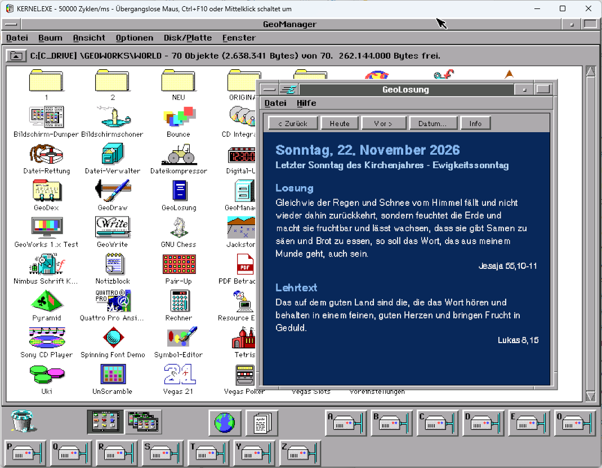
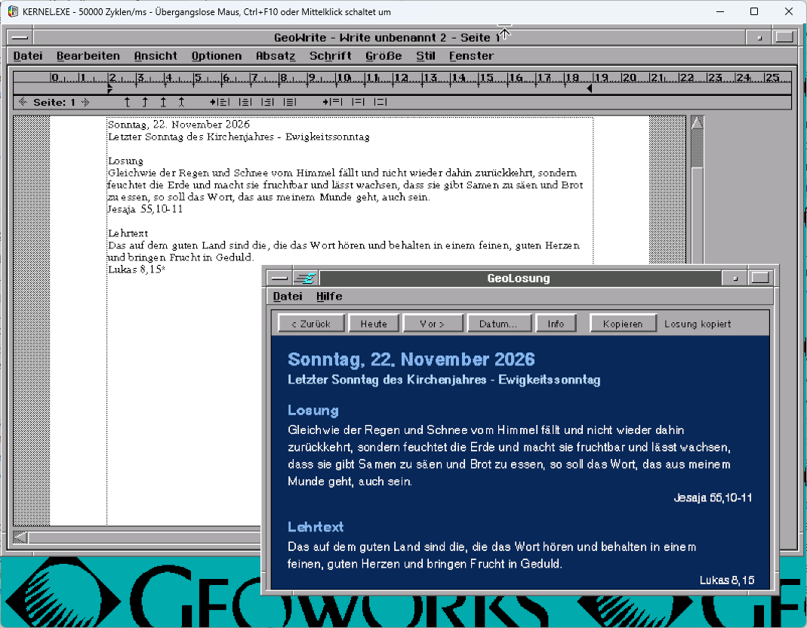

# GeoLosung

**Die Herrnhuter Losungen** für das deutsche GeoWorks Ensemble 1.2 (Kernel 1.28).
Das Programm ist in 8086-Assembler (NASM) mit dem SDK
[pcgeos-1-sdk-v2](https://github.com/dnesbitt142/pcgeos-1-sdk-v2) geschrieben.

GeoLosung zeigt beim Start die Losung des heutigen Tages, auf Wunsch gleich
beim Hochfahren von GeoWorks. Man kann zwischen den Tagen blättern, ein Datum
direkt anspringen und die Losung in die Zwischenablage kopieren. Vorbild ist
W32LOS für Windows.



## Installation

1. `dist/GEOLOS.GEO` nach `GEOWORKS\WORLD` kopieren.
2. Den Ordner `GEOWORKS\DOCUMENT\LOSUNGEN` anlegen und die Jahresdateien
   `GLOSjjjj.DAT` hineinlegen (siehe unten).
3. GeoWorks starten und im GeoManager „GeoLosung“ doppelklicken.

Anleitung: [`dist/LIESMICH.TXT`](dist/LIESMICH.TXT)

### Start beim Hochfahren

`GEOLOS.GEO` zusätzlich nach `GEOWORKS\SYSAPPL` kopieren und in der
`GEOS.INI` ergänzen:

```ini
[ui]
execOnStartup = welcome.geo geolos.geo
```

`welcome.geo` muss mit aufgeführt sein, sonst startet GeoManager nicht.

## Die Losungstexte

Die Texte liegen **nicht** in diesem Repository. Sie sind urheberrechtlich
geschützt: © Evangelische Brüder-Unität – Herrnhuter Brüdergemeine,
[www.losungen.de](https://www.losungen.de).

Die Jahresdateien erzeugt jeder selbst aus den Losungsdateien von W32LOS
(`de_losJJ.xml`):

```
umwandler\GeoLosung-Umwandeln.bat
```

Ohne Angaben liest das Skript alle `de_los*.xml` aus seinem Ordner oder aus
`C:\Program Files (x86)\w32los` und schreibt `GLOSjjjj.DAT`. Die Dateien sind
im GEOS-Zeichensatz. Die Sonn- und Feiertagsnamen berechnet das Skript selbst
aus dem Kalender. Format und Ablauf: [`umwandler/LIESMICH.TXT`](umwandler/LIESMICH.TXT).
`umwandler/geolos_ref.py` ist dieselbe Umwandlung in Python, zum Prüfen.

## Bedienung

| Funktion | Knopf / Taste |
|---|---|
| Tag zurück / vor | `< Zurück` / `Vor >`, Pfeil links / rechts, `-` / `+` |
| Heute | `Heute`, Pos1, `H` |
| Datum anspringen | `Datum…`, `D` (z. B. `24.12.2027`, `24.12.`, `24122027`) |
| In die Zwischenablage | `Kopieren`, `K`, Datei / Losung kopieren |
| Text verschieben | Pfeil hoch / runter, Bild auf / ab |
| Info, Hilfe | `Info`, `I`, Menü Hilfe |



## Bauen

```sh
SDK=/pfad/zu/pcgeos-1-sdk-v2 ./build.sh     # -> out/GEOLOS.GEO
```

| Datei | Inhalt |
|---|---|
| `app/geolos.nasm` | das Programm |
| `app/help.inc` | Hilfeseite, aus GeoMaler übernommen |
| `app/g1clip.inc` | Text in die Zwischenablage |
| `tools/help_de.txt` | Hilfetext. Daraus erzeugt `tools/gen_help.py` die Datei `app/helptext.inc` |
| `tools/postbuild.pl` | setzt Menüs „Datei“ und „Hilfe“ sowie das Symbol ein (wie beim PDF-Betrachter) |
| `icon/make_icon.py` | das Symbol: blaues Büchlein |

## Test ohne GeoWorks

`test/emu.py` führt die Programmlogik in einem 8086-Emulator (unicorn) mit
nachgebauten Kernel-Aufrufen aus. Die Jahresdateien erwartet es im Ordner
`DATADIR`:

```sh
pip install unicorn
DATADIR=/pfad/zu/den/DAT-Dateien python3 test/emu.py "$SDK/build/geolos/geolos.resource.bin"
```

## SDK-Erweiterung

[`sdk-erweiterung/SDK-ERWEITERUNG.md`](sdk-erweiterung/SDK-ERWEITERUNG.md)
beschreibt für GeoWorks 1.28 drei Dinge, die das SDK bisher nicht kannte:

- die Datumsabfrage
- die Zwischenablage mit UI-Exporten, Kernel-Aufrufen und Aufbau der Blöcke
- den Autostart über `execOnStartup`

Alles ist in GeoWorks getestet. Die wiederverwendbare Routine dazu ist
`sdk-erweiterung/g1clip.inc`.

## Versionen

- 1.0: Anzeige, Blättern, Datumseingabe, Menüs, Symbol
- 1.1: weiße Schrift normal statt fett
- 1.2: Kopieren in die Zwischenablage, Autostart
- 1.3: Hilfe im Layout von GeoMaler

## Lizenz

Programm: MIT (siehe [LICENSE](LICENSE)). Die Losungstexte gehören nicht dazu.
